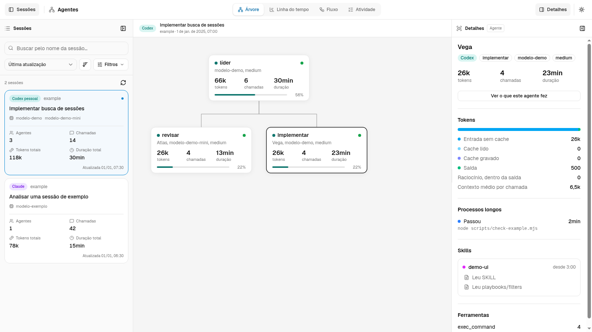
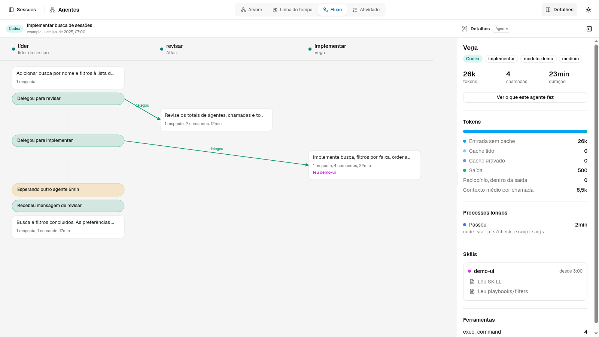
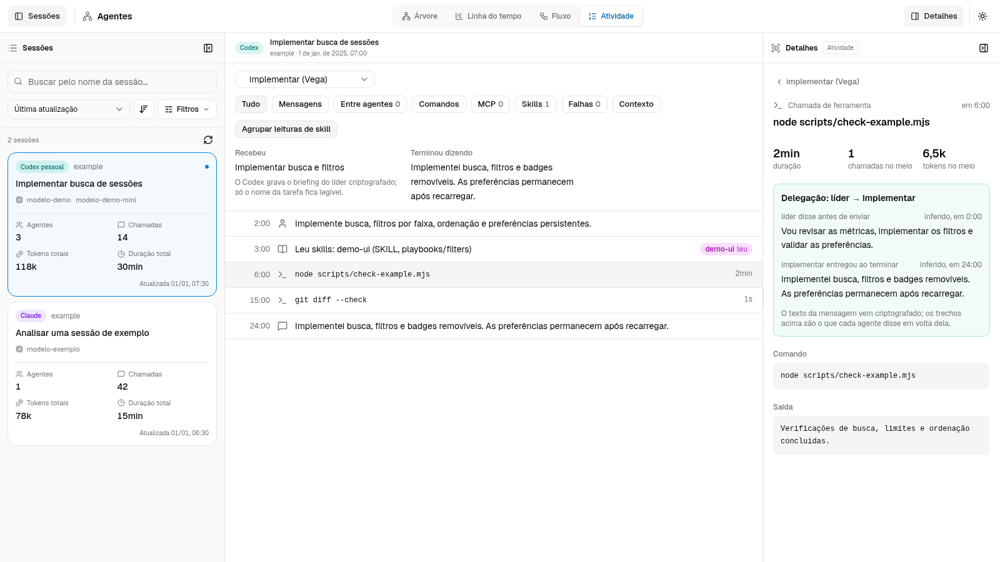

# z4-ia-agents-viewer

A local session viewer for Claude Code and Codex: explore the leader → subagent tree, with tokens, model calls, tools, and duration for each agent.

Explore agent sessions locally without sending your data to external services.

## Interface

These screenshots use fictional sessions and content, with no personal or company data. They show the current Portuguese-language interface.

**Agent tree with sessions on the left and details on the right.**



<details>
<summary>Timeline: work, waiting, and long-running processes</summary>


</details>

<details>
<summary>Flow: delegation and messages between agents</summary>



</details>

<details>
<summary>Activity: commands, skills, and outputs</summary>



</details>

## Getting started

```bash
bun install
bun run dev      # starts the API and frontend together; open the URL printed by Vite
```

The read-only API runs at `127.0.0.1:5175`. The frontend tries `http://localhost:5173` and uses another available port if needed. To run them separately, use `bun run api` in one terminal and `bun run dev:web` in another. The frontend needs the API to load sessions.

The left-hand list automatically discovers sessions in `~/.claude/projects`, `~/.codex/sessions`, `~/.codex-empresa/sessions`, and the recordings directory.

Session cards show the number of agents (including the leader), model calls, total tokens, duration, and all models used. Totals include subagents. Duration spans the earliest start to the latest event, without adding overlapping execution times. Session name search ignores case and accents. Filters can combine tool, project, model, update date range, and minimum/maximum metric values (duration is entered in minutes). Sort by name, last update, models, or any metric, in either direction. The first listing reads the logs to calculate totals; subsequent requests reuse cached results for unchanged files.

Search, filters, and sorting are saved in the browser across page reloads. Active filters appear as badges with an **X** to remove each one. **Clear all** removes all filters and the search query while keeping the selected sort order.

Open a session to explore:

- **Tree:** leader → subagents, with tokens, calls, and duration on each node.
- **Timeline:** one lane per agent. Amber blocks group waiting calls (`wait_agent`, `wait`, empty `write_stdin`, and `sleep`) and show their cost in model calls and tokens. A lower bar marks long-running processes: blue for passed, red for failed, and gray for inconclusive. Dark ticks represent tools, and dots represent model calls. Use the mouse wheel to zoom, drag to pan, and double-click to fit the whole session.
- **Flow:** a sequence diagram with one column per agent. Blocks run from top to bottom in time order. Arrows show delegation (green), messages (blue), and returns when subagents finish (dashed green). Double-click a block to open that agent's activity.
- **Activity:** everything the selected agent did, in order: the request, replies, commands and their outputs (click to inspect), delegations, messages between agents, and waits. The top section summarizes what the agent received and how it started and finished. Filter by messages, agent communication (delegations, sent and received messages, and waits for another agent), commands, MCP, skills, failures, or context. MCP calls and skill usage have badges identifying the MCP server or skill and whether the skill was invoked, loaded, read, or had a script run. Double-click a tree card to open this view.

Direct link: `http://localhost:5173/?file=<path-to-jsonl>&view=tree|timeline|flow|activity&agent=<agent-id>`.

## Workspace layout

Sessions stay on the left and selection details on the right, in independent panels that can be collapsed using the top buttons. The **Tree**, **Timeline**, **Flow**, and **Activity** tabs are in the top navigation bar. Keys **1–4** also switch views when you are not typing in a text field.

Drag the divider on the left edge of the details panel to adjust its width. With the divider focused, use the arrow keys to resize, **Shift** for larger steps, and **Home/End** for the limits. Double-click to restore the default width. On smaller screens, the panels open over the workspace and can be closed with **Esc**.

The browser remembers collapsed panels, details width, the open session, the current view, and the selected agent, item, block, or timeline segment. It also restores the tree's zoom and position, the timeline range, activity filters, and scroll positions in the flow, activity, and details panels. After a page reload, saved references are resolved against the logs again; session contents are not saved in browser storage. Explicit links take priority over the remembered session.

## CLI and tests

```bash
bun run session FILE.jsonl          # print the session tree in the terminal
bun run session FILE.jsonl --json   # output the normalized model
bun run test                       # test adapters against recorded sessions
bun run typecheck
```

Integration tests use optional recordings in `~/.local/share/agent-viewer/recordings`. Set `SESSIONS_DIR` to use a different directory. Only use fictional data in shared examples. Tests that require missing recording files are skipped.

## Project structure

| Path | Purpose |
|---|---|
| `server/model.ts` | Shared model (`Session`, `Tokens`, `SessionEvent`): types and pure functions, also used by the frontend |
| `server/adapters/codex.ts` | Codex JSONL → shared model; links children through `parent_thread_id` |
| `server/adapters/claude.ts` | Claude JSONL → shared model; loads subagents from `<sessionId>/subagents/` and deduplicates token usage by `message.id` |
| `server/analysis.ts` | Timeline analysis: waiting blocks, long-running processes (Codex cell → wait → write_stdin), and per-agent statistics |
| `server/activity.ts` | Each agent's activity in order, with grouped waits and a summary of its request, start, and result |
| `server/classify.ts` | Tags MCP calls (`mcp__srv__tool` in Claude, `srv__tool` in Codex) and skill usage (`Skill`, injected skill context, SKILL.md/playbook reads, and scripts) |
| `server/flow.ts` | Chronological blocks per agent and arrows for delegation, messages (matching sends to receipts), and returns |
| `server/discover.ts` | Discovers root sessions and aggregates subagent metrics, with per-file caching |
| `server/sessionMetrics.ts` | Streams logs to count calls, tokens, models, and elapsed time without retaining message contents |
| `server/index.ts` | Local read-only API; only opens `.jsonl` files inside the tools' session directories |
| `src/features/session-list/` | Session list and filters |
| `src/features/workspace/` | View navigation, independent panels, resizing, and layout preferences |
| `src/features/session-tree/` | Agent tree built with react-konva and session state managed with Zustand |
| `src/features/timeline/` | Timeline built with react-konva |
| `src/features/activity/` | Per-agent activity feed |
| `src/features/flow/` | Sequence diagram showing communication between agents |

Session contents are treated as data, never as instructions: the app displays text and does not execute commands from the logs.
