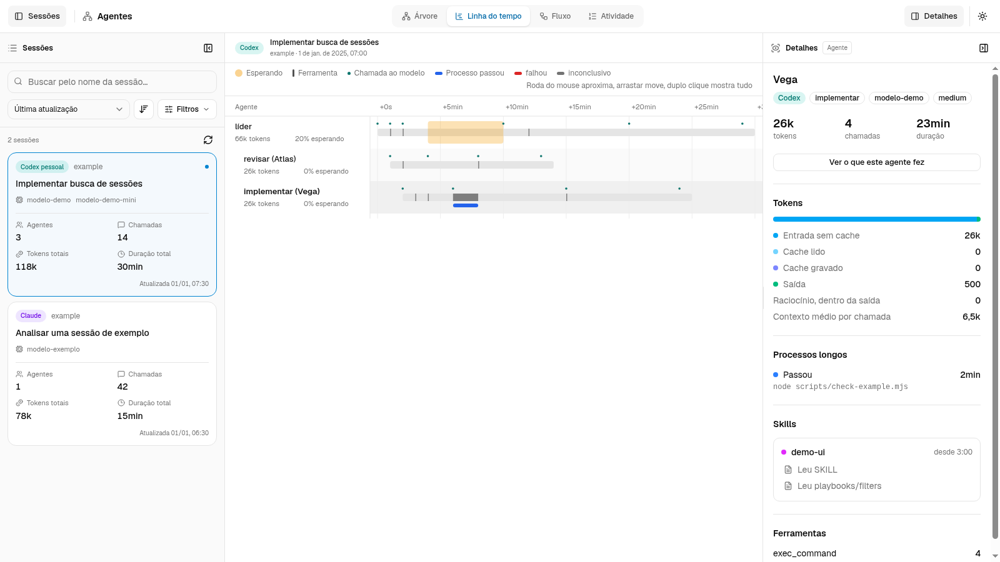

# z4-ia-agents-viwer

Visualizador local de sessões de agentes (Claude Code e Codex): a árvore líder → subagentes, com tokens, chamadas ao modelo, ferramentas e duração de cada um.

Ferramenta local para explorar sessões de agentes sem enviar os dados para serviços externos.

## Interface

Capturas com sessões e conteúdos fictícios, sem dados pessoais ou de empresas.

**Árvore de agentes com sessões à esquerda e detalhes à direita.**


<details>
<summary>Linha do tempo: trabalho, esperas e processos longos</summary>



</details>

<details>
<summary>Fluxo: delegações e mensagens entre agentes</summary>


</details>

<details>
<summary>Atividade: comandos, skills e saídas</summary>


</details>

## Rodar

```bash
bun install
bun run dev      # inicia a API e o front juntos; abra a URL exibida pelo Vite
```

A API só leitura roda em `127.0.0.1:5175`; o front tenta `http://localhost:5173` e usa outra porta livre se necessário. Para iniciar separadamente, rode `bun run api` em um terminal e `bun run dev:web` em outro. O front depende da API para carregar as sessões.

A lista da esquerda acha sozinha as sessões em `~/.claude/projects`, `~/.codex/sessions`, `~/.codex-empresa/sessions` e nas gravadas.

Os cards mostram agentes (incluindo o líder), chamadas ao modelo, tokens totais, duração e todos os modelos usados. Os totais incluem os subagentes; a duração vai do primeiro início ao último evento, sem somar execuções em paralelo. A busca pelo nome ignora maiúsculas e acentos. Em **Filtros**, combine ferramenta, projeto, modelo, período de atualização e limites mínimos/máximos das métricas (duração em minutos). A ordenação aceita nome, atualização, modelos e todas as métricas, nos dois sentidos. A primeira listagem lê os logs para calcular os totais; as próximas reaproveitam o cache dos arquivos que não mudaram.

A busca, os filtros e a ordenação ficam salvos no navegador após recarregar a página. Os filtros ativos aparecem em badges com um **X** para remover cada um; **Limpar todos** remove todos os filtros e a busca, mantendo a ordenação escolhida.

Clique numa sessão para abrir:

- **Árvore:** líder → subagentes, com tokens, chamadas e duração em cada nó.
- **Linha do tempo:** uma faixa por agente. Âmbar são as esperas (`wait_agent`, `wait`, `write_stdin` vazio, `sleep`), juntas num bloco com o custo em chamadas e tokens; a barra de baixo marca os processos longos (azul passou, vermelho falhou, cinza inconclusivo); traços escuros são as ferramentas e os pontos são as chamadas ao modelo. Roda do mouse dá zoom, arrastar move, duplo clique volta ao todo.

- **Fluxo:** diagrama de sequência, uma coluna por agente. Os blocos descem em ordem de tempo e as setas mostram cada delegação (verde), mensagem (azul) e a volta quando o subagente termina (verde tracejada). Duplo clique num bloco abre a atividade do agente.
- **Atividade:** o que o agente selecionado fez, em ordem: o pedido, as respostas, cada comando com a saída (clique para abrir), delegações, mensagens entre agentes e esperas. No topo, o que ele recebeu e como começou e terminou. Filtros por mensagens, entre agentes (delegações, mensagens enviadas e recebidas, esperas por outro agente), comandos, MCP, skills, falhas e contexto; chamadas de MCP e uso de skill ganham etiqueta (servidor MCP; skill e se foi invocada, carregada, lida ou teve script rodado). Duplo clique num cartão da árvore abre aqui.

Link direto: `http://localhost:5173/?file=<caminho do .jsonl>&view=tree|timeline|activity&agent=<id do agente>`.

## Organização da tela

As sessões ficam à esquerda e os detalhes da seleção à direita, em painéis independentes que podem ser recolhidos pelos botões do topo. As abas **Árvore**, **Linha do tempo**, **Fluxo** e **Atividade** ficam na barra superior; as teclas **1 a 4** também mudam a visualização, fora dos campos de texto.

Arraste a divisória à esquerda dos detalhes para ajustar a largura. Com ela em foco, use as setas para ajustar, **Shift** para passos maiores e **Home/End** para os limites; duplo clique restaura a largura padrão. Em telas pequenas, os painéis abrem sobre a visualização e podem ser fechados com **Esc**.

O navegador lembra os painéis recolhidos, a largura dos detalhes, a sessão aberta, a visualização e o agente, item, bloco ou trecho selecionado. Também restaura o zoom e a posição da árvore, o intervalo da linha do tempo, os filtros da atividade e a rolagem de fluxo, atividade e detalhes. As referências são resolvidas novamente nos logs após F5; o conteúdo das sessões não é salvo no armazenamento do navegador. Links explícitos têm prioridade sobre a sessão lembrada.

## CLI e testes

```bash
bun run session ARQUIVO.jsonl          # árvore no terminal
bun run session ARQUIVO.jsonl --json   # modelo normalizado
bun run test                           # adaptadores contra as sessões gravadas
bun run typecheck
```

Os testes de integração usam gravações opcionais em `~/.local/share/agent-viewer/recordings` (`SESSIONS_DIR` muda a pasta). Use somente dados fictícios nos exemplos. Sem os arquivos esperados, esses testes são pulados.

## Estrutura

| Onde | O quê |
|---|---|
| `server/model.ts` | Modelo comum (`Session`, `Tokens`, `SessionEvent`), só tipos e funções puras, usado também pelo front |
| `server/adapters/codex.ts` | JSONL do Codex → modelo; filhos por `parent_thread_id` |
| `server/adapters/claude.ts` | JSONL do Claude → modelo; subagentes em `<sessionId>/subagents/`, tokens juntados por `message.id` |
| `server/analysis.ts` | Linha do tempo: blocos de espera, processos longos (cell → wait → write_stdin no Codex) e estatísticas por agente |
| `server/activity.ts` | Sequência do que cada agente fez, com as esperas juntadas e o resumo (pedido, começo, fim) |
| `server/classify.ts` | Marca chamadas de MCP (`mcp__srv__tool` no Claude, `srv__tool` no Codex) e uso de skill (`Skill`, skill injetada, leitura do SKILL.md/playbooks, scripts) |
| `server/flow.ts` | Blocos por agente em ordem de tempo e as setas de delegação, mensagem (envio pareado com o recebimento) e volta |
| `server/discover.ts` | Acha as sessões raiz e agrega as métricas dos subagentes, com cache por arquivo |
| `server/sessionMetrics.ts` | Lê os logs em streaming para contar chamadas, tokens, modelos e intervalo de tempo sem guardar o conteúdo das mensagens |
| `server/index.ts` | API local só leitura; só abre `.jsonl` dentro das pastas das ferramentas |
| `src/features/session-list/` | Lista e filtros das sessões |
| `src/features/workspace/` | Barra de visualizações, painéis independentes, resize e preferências de layout |
| `src/features/session-tree/` | Árvore em react-konva, painel de detalhes e store zustand |
| `src/features/timeline/` | Linha do tempo em react-konva |
| `src/features/activity/` | Feed de atividade por agente |
| `src/features/flow/` | Diagrama de sequência entre agentes |

O conteúdo das sessões é dado, não instrução: a página mostra texto e nunca executa nada.
